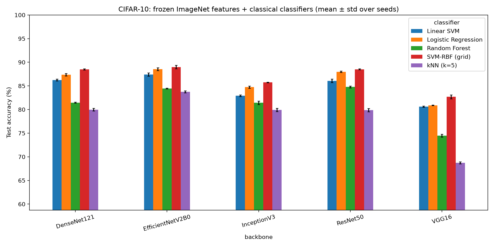
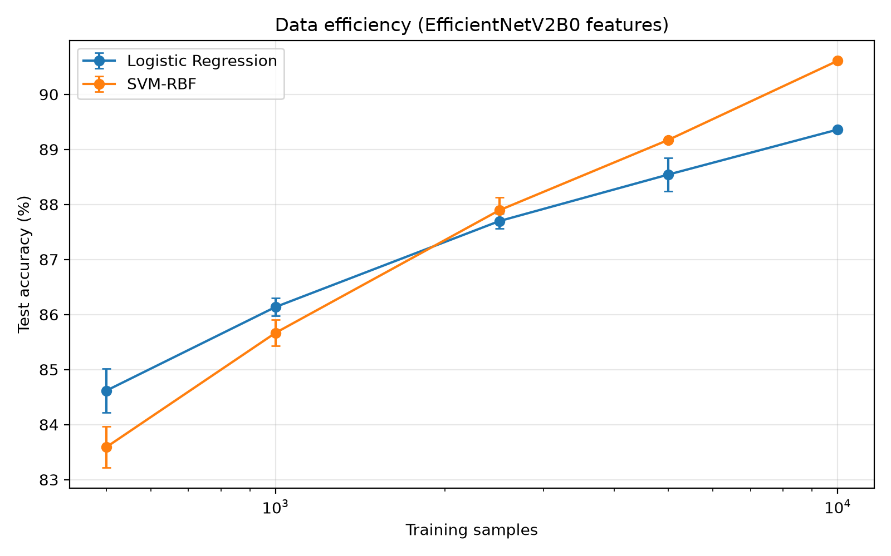

# CNN Features + SVM on CIFAR-10: a rigorous benchmark

Do classical classifiers on frozen ImageNet features compete with end-to-end fine-tuning when labelled data is scarce?

**Live demo:** _add your Hugging Face Spaces link here_

## What this project does
- Extracts frozen features from 7 backbones: 5 ImageNet CNNs (DenseNet121, VGG16, InceptionV3, ResNet50, EfficientNetV2B0) plus 2 modern self-/language-supervised ViTs (DINOv2, CLIP).
- Compares tuned RBF-SVM against Logistic Regression, Linear SVM, kNN and Random Forest on identical features.
- Hyper-parameters tuned with cross-validation on training data only; the test set is used once for reporting.
- Reports mean ± std over multiple seeds, macro-F1, fit time and per-image inference latency.
- Data-efficiency curve (accuracy vs training size), confusion matrices, optional fine-tuning baseline.
- Per-class F1, calibration (ECE + reliability diagrams) and t-SNE of the feature spaces.
- Grad-CAM (closed-form CAM of a linear probe on the frozen backbone), ONNX export with TF-vs-ONNX latency benchmark.
- `src/custom_dataset.py`: the same pipeline on any image-folder dataset (e.g. plant disease, chest X-ray).
- Streamlit demo with low-confidence rejection, and a FastAPI `/predict` endpoint.

## Results




## Reproduce
```bash
pip install -r requirements.txt
python scripts/run_all.py --quick     # smoke test
python scripts/run_all.py             # full run (add --skip_hf to skip DINOv2/CLIP)
python -m src.finetune --backbone DenseNet121   # optional fine-tuning baseline
python -m src.gradcam --backbone DenseNet121    # Grad-CAM figure
python -m src.export_onnx                       # ONNX + latency table
python -m src.custom_dataset --data_dir data/<your_dataset> --backbone DINOv2
streamlit run app/streamlit_app.py
uvicorn api.main:app --port 8000
pytest
```

## Notes and limitations
- Features come from frozen ImageNet backbones; the SVM is compared against other classifiers on the same features, not against "transfer learning" that changes the features.
- CIFAR-10 images are 32x32 upsampled to 224/299 px; real photos are a domain shift, hence the confidence threshold in the demo.
